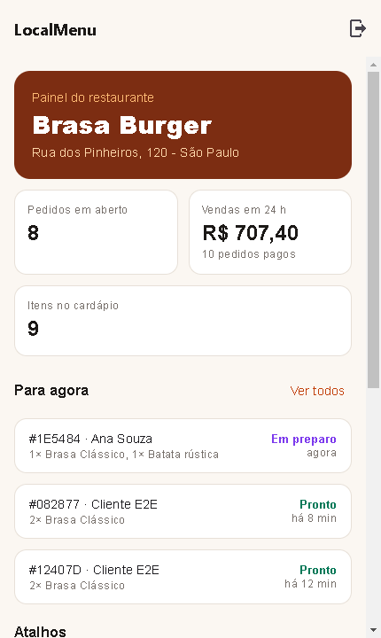
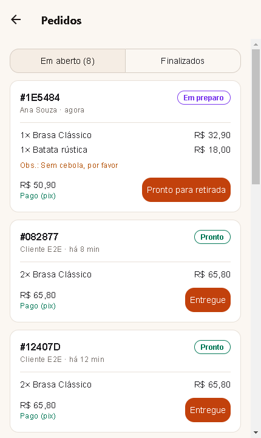
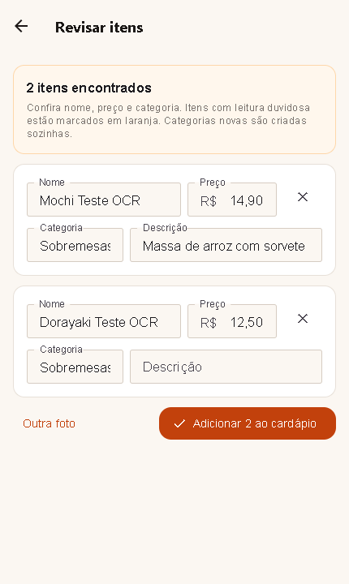

# LocalMenu B2B

Painel do restaurante do LocalMenu, em React Native (Expo) e TypeScript. O dono monta o cardápio (à mão ou fotografando o cardápio de papel), recebe os pedidos dos clientes, avança cada um até a retirada e acompanha as vendas. Roda 100% local, ligado ao [localmenu_backend](https://github.com/lucax011/localmenu_backend).

| Painel                              | Pedidos                               | Importar por foto                                                       |
| ----------------------------------- | ------------------------------------- | ----------------------------------------------------------------------- |
|  |  |  |

## Ecossistema LocalMenu

| Repositório                                                                | Papel                                    |
| -------------------------------------------------------------------------- | ---------------------------------------- |
| [localmenu_backend](https://github.com/lucax011/localmenu_backend)         | API NestJS + PostgreSQL                  |
| [localmenu_frontendB2C](https://github.com/lucax011/localmenu_frontendB2C) | App do cliente (Expo)                    |
| [localmenu_frontendB2B](https://github.com/lucax011/localmenu_frontendB2B) | App do restaurante (Expo)                |
| [localmenu_OCRservice](https://github.com/lucax011/localmenu_OCRservice)   | Microsserviço de OCR em Python (FastAPI) |

## O que o dono faz

1. Entra com a conta de dono.
2. **Painel:** pedidos em aberto, vendas das últimas 24 h e os pedidos que pedem ação agora.
3. **Cardápio:** categorias e itens, com foto, preço, descrição e disponibilidade. A foto sobe na hora (JPEG ou PNG, até 5 MB) e aparece no app do cliente.
4. **Importar por foto:** fotografa o cardápio de papel; a API manda a foto para o OCR, o dono revisa nome, preço e categoria de cada item e adiciona tudo de uma vez.
5. **Pedidos:** aceita ou recusa, começa o preparo, marca como pronto e como entregue. A lista atualiza sozinha a cada 10 segundos.
6. **Vendas:** faturamento, ticket médio e itens mais vendidos por período.
7. **Meu restaurante:** capa, logo, nome, descrição, telefone e endereço que o cliente vê. Capa e logo salvam assim que a foto sobe.

## Stack

- Expo SDK 51 (React Native 0.74, web pelo Metro)
- React Navigation, React Query, Zustand (sessão guardada no aparelho)
- React Native Paper, react-hook-form + zod, expo-image-picker
- Jest, Cypress (e2e contra a API local), ESLint, Prettier, Husky + lint-staged

## Como rodar

Pré-requisito: a API rodando em `http://localhost:3000`. O README do [localmenu_backend](https://github.com/lucax011/localmenu_backend#subir-tudo-api-ocr-e-os-dois-apps) tem o passo a passo para subir tudo.

```sh
npm install
npm run web        # abre em http://localhost:8081
```

Conta de exemplo: `dono@localmenu.dev` / `localmenu123` (dono do Brasa Burger).

O servidor de desenvolvimento fica preso a `127.0.0.1`: o `scripts/somente-localhost.cjs` impede que o Expo abra a porta para a rede. Para testar num celular pelo Expo Go, rode `npx expo start` direto, sabendo que a porta fica visível na rede local.

Para apontar para outra API, copie `.env.example` para `.env` e ajuste `EXPO_PUBLIC_API_BASE_URL`.

### Versão de produção (Docker)

```sh
docker compose up --build    # http://localhost:8081, só em 127.0.0.1
```

Gera o site estático e serve pelo Nginx. A URL da API entra no build (`EXPO_PUBLIC_API_BASE_URL`). Use a mesma porta 8081 do desenvolvimento, que é a que o CORS da API libera; pare o `npm run web` antes.

## Scripts

| Comando             | O que faz                                                                |
| ------------------- | ------------------------------------------------------------------------ |
| `npm run web`       | Expo Web na porta 8081, só em 127.0.0.1                                  |
| `npm test`          | Testes unitários (preços, pedidos, validação)                            |
| `npm run e2e`       | Cypress contra a API local: importação por foto e pedido indo até pronto |
| `npm run typecheck` | Checagem de tipos                                                        |
| `npm run lint`      | ESLint + Prettier                                                        |
| `npm run build:web` | Gera o site estático em `dist/`                                          |

O e2e precisa da API e do app rodando. Ele cria seus próprios dados (um cliente e um pedido novos) e apaga os itens que importa.

## Estrutura

```
App.tsx                 navegação
src/
  api/                  cliente da API (token com renovação automática) e tipos
  store/                sessão
  hooks/                restaurante e cardápio do dono
  features/
    auth/               login
    dashboard/          painel
    menu/               cardápio e formulário de item
    ocr/                importar por foto e revisar itens
    orders/             pedidos
    reports/            vendas
    restaurant/         dados do restaurante
  components/ui.tsx     peças visuais comuns
  utils/                formatos e validação
cypress/e2e/            testes ponta a ponta
```

## Licença

MIT. Veja [LICENSE](LICENSE).
